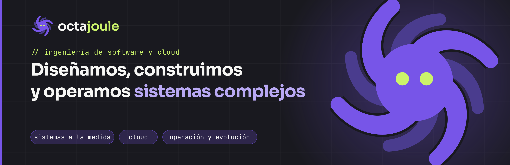

  

**Octajoule es una empresa de ingeniería de software y cloud.** Diseñamos, construimos y operamos sistemas a la medida, arquitecturas en Azure y AWS e integraciones complejas para empresas en Colombia, Latinoamérica, Estados Unidos y España.

> *La energía detrás de cada idea.*

---

### Qué hacemos

| | |
|---|---|
| **Desarrollo de sistemas** | Sistemas a la medida, plataformas de operación, portales, plataformas transaccionales e integraciones con ERP, facturación electrónica, pagos y APIs de terceros. Construidos por fases: descubrir, prototipar, construir, lanzar y mejorar. |
| **Cloud** | Arquitectura, migración y modernización en Azure y AWS: contenedores, serverless, infraestructura como código, CI/CD, alta disponibilidad, recuperación ante desastres y optimización de costos. |
| **Operación y evolución** | Operamos tus sistemas (monitoreo, respaldos, seguridad) y los seguimos mejorando cada mes, con capacidad de desarrollo continua. |

### Cómo trabajamos

Empezamos con un **discovery técnico**: talleres con tu equipo, revisión de lo que existe, arquitectura propuesta, plan por fases, cronograma y presupuesto. Después construimos con entregas frecuentes, pruebas automáticas y revisión de código.

- **Sin cajas negras:** código, documentación y manuales de operación entregados con licencia perpetua de uso.
- **Código que otros pueden mantener:** estándares claros, para que el sistema no dependa de una sola persona.
- **Puedes seguir con nosotros o sin nosotros.**

### Stack

  
  
  
  
  
  
  
  
  

### Productos

- **[Abassto](https://abassto.app):** el punto de venta que te da el control de tu tienda. Caja registradora y portal web para tiendas, minimercados y supermercados de Colombia; cobra aunque se caiga el internet.

### Contacto

[**Agenda un discovery técnico**](https://octajoule.com/como-trabajamos) · [octajoule.com](https://octajoule.com) · [hola@octajoule.com](mailto:hola@octajoule.com)

🇬🇧 Octajoule is a software and cloud engineering company: we design, build and operate custom systems, Azure/AWS architectures and complex integrations. Nearshore, in your time zone.
